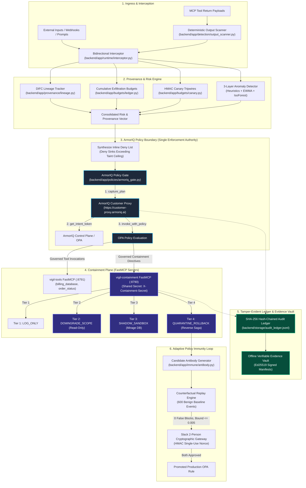

# VIGIL: End-to-End System Architecture, Governance & Technical Specification

> **The Definitive Single-Source-of-Truth Guide for Claude on VIGIL**  
> *Autonomous AI Runtime Immune System Native to the ArmorIQ Policy Platform (`armoriq-sdk==0.6.10`)*

---

## 1. System Mission & Core Thesis

**VIGIL** is an enterprise-grade, policy-driven behavioral immune system for autonomous multi-agent AI ecosystems.

### The Core Thesis
> **"We win on safe blocking. False blocks are the metric we minimise. Attacks blocked is secondary."**

In enterprise deployments, naive security controls (e.g., regex filters, keyword blocks, client-side heuristic aborts) create a catastrophic false dichotomy:
1. **Permissive Governance**: Unchecked agent autonomy allows prompt injections, confused deputy delegations, and data exfiltration.
2. **Naive Heuristic Blocking**: False blocks disrupt legitimate business workflows, breaking production agent pipelines and destroying trust.

VIGIL solves this by transforming detection into an **active immune loop**:
- Threat indicators (lineage taint, exfiltration budgets, canary trips, and scanner alerts) are computed dynamically.
- These indicators are passed as **inputs** to the **ArmorIQ Policy Platform**, which acts as the **single authority** for all tool-call block decisions.
- Confirmed incidents are synthesized into candidate Open Policy Agent (OPA) deny rules.
- **Every candidate rule is counterfactually replayed over historical benign traffic** to mathematically prove zero disruption ($\le 0.5\%$ one-sided Clopper-Pearson 95% upper bound over 600 benign records) before requiring two-person human approval via Slack.
- Every platform decision produces an offline-verifiable Ed25519 receipt sealed in a SHA-256 hash-chained ledger.

---

## 2. Non-Negotiable Foundational Invariants

Any code written for VIGIL must strictly abide by these rules. Static AST tests and CI checks enforce them automatically:

### 2.1 Core Operational Rules (P0)
1. **Fail Closed**: Any check that errors, times out, encounters a network partition, or returns unexpected types must **deny** or **escalate** to human operators. Never approve by default.
2. **One Enforcement Path**: Containment and policy modifications must traverse the ArmorIQ Gate (`backend/app/policies/armoriq_gate.py`) and the governance approval workflow. Zero direct status writes, zero direct database mutators, and zero timer-based releases.
3. **Ground Truth Labels**: Ground truth labels never originate from the detector. Labels come strictly from the simulator or human-confirmed incidents. Unlabeled production traffic is designated `"assumed benign"`, and every report must state this explicitly.
4. **Dry-Run by Default**: Writing ArmorIQ registration YAMLs, syncing with the live platform, or quarantining agents requires an approved proposal and an explicit `--live` flag. A mock environment may quarantine or write only with output labelled `NOT ENFORCED BY ARMORIQ`.
5. **Zero Secrets in History**: API keys (`ARMORIQ_API_KEY`), local operator secrets (`LOCAL_OPERATOR_SECRET`), and HMAC seeds must never be logged, committed to git, or stored in `evidence/`. All secrets must be redacted to `[REDACTED]`.

### 2.2 VIGIL v3 Architectural Rules (Rules A through J)
- **Rule A (Single Authority - ArmorIQ Decides)**: Only ArmorIQ decides whether an agent's tool call is allowed or blocked. VIGIL computes provenance taint, exfiltration budgets, canary trips, and scanner output, passing them to ArmorIQ as inputs (mint-time inline policies, plan steps, or containment directives). VIGIL never returns `allowed: False` or `allowed: True` for an agent tool call on its own. *(Enforced by AST test: [`backend/tests/test_static_tool_decision_boundary.py`](backend/tests/test_static_tool_decision_boundary.py))*.
- **Rule B (Containment via FastMCP)**: Every containment action (downgrade, shadow routing, quarantine, rollback) is executed as an ArmorIQ-authorized tool call on the FastMCP containment server (`vigil-containment`, port 8790) authenticated via `X-Containment-Secret` header. Data-plane effects occur only after ArmorIQ authorizes the directive, and each is recorded in the ledger.
- **Rule C (Statistical Rigor)**: Statistical claims are reported as exact statistical bounds, never unscientific point estimates. Zero events in $n$ trials is strictly reported as:
  $$	ext{"0 of } n 	ext{; one-sided 95% upper bound from Clopper-Pearson"}$$
  Writing "0% FPR" for a finite sample is strictly forbidden.
- **Rule D (No Hardcoded Metrics)**: All percentages, scores, latency benchmarks, and badge texts in UI components or demo scripts must be dynamically computed by the pipeline or loaded from API props. Source code is scanned for hardcoded numeric literals in metric contexts. *(Enforced by: [`frontend/src/tests/v3_ui.test.tsx`](frontend/src/tests/v3_ui.test.tsx))*.
- **Rule E (Antibodies as Proposals Only)**: LLM-synthesized candidate rules are proposals. They are parsed as strict JSON against a Pydantic schema (`extra: forbid`), counterfactually backtested on 600+ benign records (proving upper bound $\le 0.005$), and submitted for human approval. They are never executed directly and never auto-applied to production.
- **Rule F (Deception is Sandbox-Only)**: Honeypots (`honeypot_mirage.db`) and canary tripwires are strictly confined to the sandbox. They never receive production credentials or real user records. All synthetic decoys are disclosed in [`docs/SANDBOX.md`](docs/SANDBOX.md), and operators see every shadow routing decision in the ledger.
- **Rule G (Compensations)**: Compensating rollbacks exist only for tools that declare an explicit inverse in [`config/tool_compensations.yaml`](config/tool_compensations.yaml). All other tools are designated `IRREVERSIBLE`. Compensating invocations are also ArmorIQ-authorized.
- **Rule H (Single Threshold Table)**: Every score threshold, sliding window budget, and timeout lives centrally in [`config/thresholds.yaml`](config/thresholds.yaml). No magic numbers in code. *(Enforced by AST test: [`backend/tests/test_one_threshold_table.py`](backend/tests/test_one_threshold_table.py))*.
- **Rule I (App Package Architecture)**: All new code belongs under the structured package [`backend/app/`](backend/app/). Never create flat `backend/*.py` modules, and never import from `archive/`.
- **Rule J (Novelty Needs Prior Art)**: An innovation claim remains designated `UNVERIFIED` until external academic literature is cataloged in `docs/research/`, citing sources provided by human researchers.

---

## 3. High-Level System Architecture



---

## 4. The ArmorIQ Platform Integration (`armoriq-sdk==0.6.10`)

VIGIL v3 strictly integrates with the official ArmorIQ Python SDK:
```bash
pip install armoriq-sdk==0.6.10
```

### 4.1 The Three-Step Governed Execution Flow
Every interaction with an external tool or containment action follows this exact 3-step sequence matching actual `armoriq-sdk` signatures:

1. **`client.capture_plan(llm: str, prompt: str, plan: Optional[Dict[str, Any]] = None, metadata: Optional[Dict[str, Any]] = None) -> PlanCapture`**:
   Captures the LLM execution plan, generating a deterministic plan hash and returning a `PlanCapture` instance (`plan_capture_id`, `plan_hash`).
2. **`client.get_intent_token(plan_capture: PlanCapture, policy: Optional[Dict[str, Any]] = None, validity_seconds: float = 60.0) -> IntentToken`**:
   Exchanges the captured plan with ArmorIQ. An inline deny policy (derived dynamically from VIGIL taint ceilings) is attached via `policy`. Returns a cryptographically signed `IntentToken` valid for `validity_seconds`.
3. **`client.invoke_with_policy(mcp: str, action: str, intent_token: IntentToken, params: Optional[Dict[str, Any]] = None, options: Optional[InvokeOptions] = None) -> MCPInvocationResult`**:
   Sends the tool call through the ArmorIQ Customer Proxy (`https://customer-proxy.armoriq.ai`). The proxy validates the token and OPA rules against target `mcp` server, `action` tool, and argument `params`. Optional governance arguments are passed via `InvokeOptions(*, wait_for_approval=None, delegation_timeout_ms=None, on_hold=None, user_email=None, requester_role=None, requester_limit=None)`. If unauthorized, the proxy raises `PolicyBlockedException`.

### 4.2 Critical Negative Finding: Mint-Time vs Invoke-Time Enforcement
Live empirical probing (`scripts/probe_mint_live.py` -> [`evidence/P1/mint_probe.json`](evidence/P1/mint_probe.json)) revealed that:
- `client.get_intent_token` **does NOT** evaluate inline deny rules or raise `PolicyBlockedException` at mint time. It successfully returns a signed token.
- Denial occurs downstream at **invoke time** (`client.invoke_with_policy`), where ArmorIQ's OPA engine blocks the call and raises `PolicyBlockedException`:
  - `enforcement_action = "block"`
  - `reason = "policy_constraints_not_satisfied"`
  - `metadata = {"layer": "opa"}`
- **Architectural Consequence**: Per Rule A, VIGIL does not invent a client-side plan-vetting pre-check. Instead, VIGIL cleanly attaches inline policies during minting and allows ArmorIQ to execute the definitive block at invocation time.

### 4.3 Fail-Closed Decision Matrix
| Exception / Return State | VIGIL Internal Verdict | Data Plane Action |
|---|---|---|
| `PolicyBlockedException` | `DENIED` | Call blocked by ArmorIQ proxy (`metadata={'layer': 'opa'}`); logged in ledger. |
| `PolicyHoldException` | `ESCALATE` | Call suspended pending human operator review; never auto-approved. |
| `IntentTokenError` / `ArmorIQException` | `ESCALATE` | Token minting error or ArmorIQ protocol fault; fails closed. |
| `httpx.HTTPError` / `httpx.TimeoutException` | `ESCALATE` | Transport connection error or timeout; fails closed without executing. |
| Valid `MCPInvocationResult` | `ALLOWED` | Tool executes; response scanned and returned. |

---

## 5. Detailed Component Breakdown

### 5.1 Provenance & DIFC Taint Engine (`backend/app/provenance/lineage.py`)
Tracks information flow across multi-agent delegation chains (e.g., `CustomerBot` $
ightarrow$ `AnalyticsAgent` $
ightarrow$ `BillingAgent`):
- **4 DIFC Taint Levels**:
  0. `SYSTEM_TRUSTED` (0): Internal hardened system components.
  1. `VERIFIED_INTERNAL` (1): Authenticated internal agents and verified internal storage.
  2. `USER_UNTRUSTED` (2): Raw inputs from authenticated users.
  3. `EXTERNAL_POISON_RISK` (3): Unverified webhooks, public web content, or indirect prompt injections.
- **Monotonic Propagation**: Child spans inherit the maximum taint level of their parent lineage:
  $$	ext{Taint}(	ext{Child}) = \max(	ext{Taint}(	ext{Parent}), 	ext{Taint}(	ext{Input}))$$
- **Cycle & Depth Ceilings**: Lineage chains exceeding 6 delegation hops are flagged as `DEGRADED` to prevent resource exhaustion attacks.
- **Restricted Sink Mapping ([`config/sinks.yaml`](config/sinks.yaml))**:
  When an agent attempts to invoke a sink tool (e.g., `billing_database`), VIGIL checks if the lineage taint exceeds the sink ceiling (`VERIFIED_INTERNAL`). If so, VIGIL adds `vigil-tools/billing_database` to the inline deny policy sent to ArmorIQ.

### 5.2 Graduated Containment Ladder (`backend/app/policies/containment_ladder.py`)
Replaces crude binary kill switches with 4 graduated operational tiers:
1. **Tier 1: `LOG_ONLY`** ($S < 0.45$):
   Normal operations; full tool capabilities retained; telemetry recorded to ledger.
2. **Tier 2: `DOWNGRADE_SCOPE`** ($0.45 \le S < 0.75$):
   Surgically restricts the session to read-only capabilities (e.g., `order_status` allowed; `billing_database` stripped).
3. **Tier 3: `SHADOW_SANDBOX`** ($0.75 \le S < 0.90$):
   Silently multiplexes database queries to the synthetic **Mirage Honeypot** ([`backend/app/runtime/mirage.py`](backend/app/runtime/mirage.py), `honeypot_mirage.db`) to observe attacker Tactics, Techniques, and Procedures (TTPs) without disruption or exposure of real data.
4. **Tier 4: `QUARANTINE_ROLLBACK`** ($S \ge 0.90$ or canary hit):
   Full session isolation, credential revocation, and execution of backward compensating rollbacks.

*Actuation Mechanism*: Executed as FastMCP tool calls on `vigil-containment` (port 8790) via encrypted tunnel authenticated by `X-Containment-Secret` header.

### 5.3 Low-and-Slow Budgets & Canaries (`backend/app/budgets/`)
Traditional detectors evaluate single-turn volume, missing stealthy, chunked exfiltration. VIGIL introduces:
- **Sliding-Window Ledgers ([`backend/app/budgets/ledger.py`](backend/app/budgets/ledger.py))**:
  - **1-Minute Window**: 10 KB limit (`10,240` bytes).
  - **1-Hour Window**: 100 KB limit (`102,400` bytes).
  - **Inclusive Boundary Rule**: Budget threshold comparisons are inclusive (`>=`). Equality triggers a breach (e.g., cumulative 10,240B $\ge$ 10,240B window ceiling trips immediately at chunk 5).
  - **Shannon Entropy Ceiling**: $H \ge 5.8$ bits flags encrypted, compressed, or high-density payloads.
  - **Privacy Invariant**: Persists rolling byte aggregates and timestamps only; raw payloads are discarded.
- **Cryptographic Canary Tripwires ([`backend/app/budgets/canary.py`](backend/app/budgets/canary.py))**:
  - Injects synthetic honey-rows into sandbox decoy queries containing ephemeral HMAC-SHA256 canary tokens.
  - Any attempt by an agent or external caller to access or exfiltrate a canary token triggers an immediate, deterministic jump to Tier 4 (`QUARANTINE_ROLLBACK`).

### 5.4 Schema Pinning & Output Scanning (`backend/app/runtime/pinning.py`, `backend/app/detection/output_scanner.py`)
- **Schema Hash Pinning**:
  Computes canonical SHA-256 hashes of registered MCP tool schemas. If a malicious MCP server modifies tool parameters or descriptions post-registration ("tool rug-pull"), the hash mismatch elevates taint and flags the session.
- **Deterministic Bidirectional Output Scanner**:
  Scans MCP tool return payloads before they enter the agent's LLM context window. Detects role-marker injections (e.g., `<system>`, `[INST]`, `ADMIN_OVERRIDE`) and indirect prompt manipulation, elevating child taint to Level 3 (`EXTERNAL_POISON_RISK`) without client-side blocking.

### 5.5 Policy Immune Synthesis & Replay Engine (`backend/app/immune/`)
Transforms forensic incident traces into durable, proven OPA security policies:
1. **Candidate Synthesis ([`backend/app/immune/antibody.py`](backend/app/immune/antibody.py))**:
   Generates a candidate deny rule targeting the compromised tool and agent. Output is validated against a strict Pydantic model (`CandidateRuleSchema`, `extra: forbid`).
2. **Counterfactual Replay ([`backend/app/immune/replay.py`](backend/app/immune/replay.py))**:
   Evaluates the candidate rule against $\ge 600$ historical benign action records from the ledger.
   - Computes empirical attack coverage ($C \ge 90\%$).
   - Computes exact false blocks ($0$ false blocks required).
   - Computes the one-sided 95% Clopper-Pearson upper bound ($ar{p} \le 0.005$). Over 600 benign trials with 0 false blocks, $ar{p} = 1 - 0.05^{1/600} pprox 0.004980 \le 0.005$.
3. **Slack Governance Channel ([`backend/app/channels/slack.py`](backend/app/channels/slack.py))**:
   Promotes the rule as a formal proposal to `#vigil-approvals`. Requires two distinct operators to authenticate approval with single-use cryptographic nonces.

### 5.6 Compensating Rollbacks & Blast Radius (`backend/app/runtime/rollback.py`)
Implements the distributed Saga pattern for agent tool invocations:
- **Declarative Compensations Table ([`config/tool_compensations.yaml`](config/tool_compensations.yaml))**:
  Declares the exact inverse tool and argument mappings (e.g., `update_customer_account` $
ightarrow$ `revert_customer_account`).
- **Deterministic State Hashes**: Pre-state snapshots are verified against SHA-256 hashes before and after compensation.
- **Irreversible Actions**: Actions with external real-world side effects (`send_external_email`, `wire_transfer_funds`, `terminal_exec`) are explicitly cataloged as `IRREVERSIBLE`, preventing corrupted partial compensations and escalating to human remediation.
- **Blast Radius DAG**: Recursively traverses dependent downstream tool calls to identify all affected records and entities.

---

## 6. Single Source of Truth: Centralized Thresholds

All system thresholds are consolidated in [`config/thresholds.yaml`](config/thresholds.yaml). Hardcoded constants in application logic are strictly forbidden:

```yaml
detection:
  anomaly_score_threshold: 0.45       # Base Isolation Forest / heuristic threshold

containment_ladder:
  log_only_ceiling: 0.45              # Tier 1 ceiling
  surgical_downgrade_range: [0.45, 0.75]  # Tier 2 range
  mirage_honeypot_range: [0.75, 0.90]     # Tier 3 range
  quarantine_rollback_threshold: 0.90     # Unified system-wide quarantine and rollback trigger

governance:
  escalate_threshold: 0.65            # Human approval escalation threshold in gate
  quarantine_threshold: 0.90          # Single unified quarantine threshold

provenance_and_lineage:
  max_delegation_depth: 6             # Max hops before DEGRADED
  restricted_sink_ceilings:
    billing_database: "VERIFIED_INTERNAL"
    export_financial_records: "SYSTEM_TRUSTED"
    iam_role_grant: "SYSTEM_TRUSTED"

low_and_slow_budgets:
  window_1m_bytes_max: 10240          # 10 KB / 1-minute window (inclusive >=)
  window_1h_bytes_max: 102400         # 100 KB / 1-hour window (inclusive >=)
  shannon_entropy_threshold: 5.8      # Shannon entropy threshold (bits)
  canary_hit_trigger_count: 1         # 1 hit triggers instant quarantine

policy_immune:
  min_coverage: 0.90                  # 90% attack coverage required
  max_false_block_upper: 0.005        # 0.5% max Clopper-Pearson upper bound
  min_benign_records: 600             # Minimum historical baseline records
  min_attack_records: 3               # Minimum incident traces
  delta_significance: 0.05            # 95% Confidence Level (1 - delta)
  antibody_backtest_window: 600       # 600 benign events replayed for antibodies
```

---

## 7. Statistical Rigor Protocol

VIGIL rejects unscientific claims such as "0.0% false positives" on finite datasets. 

### The Clopper-Pearson One-Sided Upper Bound Formula
When zero false-positive events are observed across $n$ independent trials ($k=0$) at significance level $\delta = 0.05$ ($95\%$ confidence level):
$$ar{p}_{1-\delta} = 1 - \delta^{1/n}$$

| Sample Size ($n$) | False Blocks ($k$) | Exact Clopper-Pearson 95% Upper Bound | Compliant Reporting String | Evidence Source |
|---|---|---|---|---|
| **600 trials** | 0 | **0.4980%** ($pprox 0.5\%$) | `"0 of 600; one-sided 95% upper bound from Clopper-Pearson: 0.498%"` | [`evidence/V8/scenario_6.json`](evidence/V8/scenario_6.json) |
| **620 trials** | 0 | **0.4820%** ($pprox 0.48\%$) | `"0 of 620; one-sided 95% upper bound from Clopper-Pearson: 0.482%"` | [`evidence/M6/demo_output.txt`](evidence/M6/demo_output.txt) |
| **1,000 trials**| 0 | **0.2991%** ($pprox 0.3\%$) | `"0 of 1000; one-sided 95% upper bound from Clopper-Pearson: 0.299%"` | [`evidence/V9/results.json`](evidence/V9/results.json) |
| **215,000 trials**| 0 | **0.00139%** ($pprox 0.0014\%$) | `"0 of 215000; one-sided 95% upper bound from Clopper-Pearson: 0.0014%"` | [`evidence/I1/results.json`](evidence/I1/results.json) |

---

## 8. Empirical Evidence & Benchmark Results

Every metric reported in VIGIL documentation maps directly to immutable JSON evidence files and is explicitly classified by run environment:

### 8.1 Scenario 5: Confused Deputy Multi-Hop Delegation
- **Source Script**: [`scripts/scenario_confused_deputy.py`](scripts/scenario_confused_deputy.py)
- **Evidence Receipt**: [`evidence/V8/scenario_5.json`](evidence/V8/scenario_5.json)
- **Measured Workflow**:
  1. `CustomerBot` ingests ticket #8821 `[OFFLINE-HARNESS]` containing indirect prompt injection instructions.
  2. `CustomerBot` delegates to `AnalyticsAgent`, which delegates to `BillingAgent`.
  3. Isolated threat detector score on `BillingAgent` alone is **`0.0`** `[OFFLINE-HARNESS]` (appears benign because `BillingAgent` normally queries billing).
  4. VIGIL's DIFC engine tracks lineage taint from root, elevating taint to `EXTERNAL_POISON_RISK` (Level 3) `[OFFLINE-HARNESS]`.
  5. Intent token minting attaches inline deny for `vigil-tools/billing_database`.
  6. ArmorIQ OPA proxy enforces the block (`PolicyBlockedException`, status: `ARMORIQ_ENFORCED`, metadata: `{'layer': 'opa'}`).

### 8.2 Scenario 6: Low-and-Slow Exfiltration, Canary Trip & Antibody Synthesis
- **Source Script**: [`scripts/scenario_low_and_slow.py`](scripts/scenario_low_and_slow.py)
- **Evidence Receipt**: [`evidence/V8/scenario_6.json`](evidence/V8/scenario_6.json)
- **Measured Workflow**:
  1. `AnalyticsAgent` exfiltrates data in chunks of 2,048 bytes `[OFFLINE-HARNESS]`.
  2. Budget ledger monitors sliding 1-minute ceiling of 10,240 bytes `[OFFLINE-HARNESS]`.
  3. First alert triggers at **chunk 5** `[OFFLINE-HARNESS]` (cumulative 10,240 bytes $\ge$ 10,240 bytes inclusive ceiling) $
ightarrow$ tier transitions to `DOWNGRADE_SCOPE`.
  4. Canary token (`canary_token_0`) trips at **chunk 24** `[OFFLINE-HARNESS]` $
ightarrow$ tier escalates to `QUARANTINE_ROLLBACK`.
  5. Auto-antibody synthesized and replayed across 600 benign events `[OFFLINE-HARNESS]`:
     - 0 false blocks `[OFFLINE-HARNESS]` (95% one-sided Clopper-Pearson upper bound: **`0.00498`** $\le 0.005$) `[OFFLINE-HARNESS]`.
     - Recall: **`1.0`** (100% attack coverage) `[OFFLINE-HARNESS]`.
     - Measured offline antibody pipeline execution time: **`0.0331s`** `[OFFLINE-HARNESS]`. Covers candidate deny-rule synthesis and counterfactual replay over 600 benign historical ledger records (compared to 3.0s proposal estimate) `[OFFLINE-HARNESS]`.

### 8.3 Ablation Benchmark Progression (E0 to E5 across 1,080 trials)
- **Source Script**: [`bench/v3/run_ablations.py`](bench/v3/run_ablations.py)
- **Evidence Receipt**: [`evidence/V9/results.json`](evidence/V9/results.json), [`evidence/V9/results.md`](evidence/V9/results.md)
- **Evaluation Total**: Evaluates 1,080 total traces `[OFFLINE-HARNESS]` consisting of 80 attack evaluation traces across 4 scenario families (20 confused deputy, 20 low-and-slow, 20 tool rug-pull, 20 injected output) and 1,000 benign traffic operations (500 delegations + 500 bulk reads).
- **Statistical Intervals**: All attack detection intervals are exact two-sided 95% Clopper-Pearson confidence intervals over the $n=80$ attack evaluation traces. E0's interval is [0.0%, 4.5%] matching its exact $n=80$ denominator ($k=0$).
- **Reproducibility**: Repeated runs with `seed=42` yield 100% bit-for-bit identical results (0 diff).

| Configuration | Enabled Layers | Attack Detection Rate [Two-Sided 95% CI] | Mean Events to Alert | Benign Disruption / 1,000 Events |
|---|---|---|---|---|
| **E0** `[OFFLINE-HARNESS]` | Baseline (Single-Turn Heuristics Only) | **0.0%** [0.0%, 4.5%] | N/A (Missed) | 0.0 / 1k |
| **E1** `[OFFLINE-HARNESS]` | + DIFC Lineage Taint Propagation | **25.0%** [16.0%, 35.9%] | 3.0 events | 0.0 / 1k |
| **E2** `[OFFLINE-HARNESS]` | + Sliding Budgets (1m/10KB, 1h/100KB, Entropy) | **50.0%** [38.6%, 61.4%] | 4.0 events | 0.0 / 1k |
| **E3** `[OFFLINE-HARNESS]` | + HMAC Canary Sandbox Tripwires | **50.0%** [38.6%, 61.4%] | 4.0 events | 0.0 / 1k |
| **E4** `[OFFLINE-HARNESS]` | + Output Scanning & Canonical Schema Pinning | **100.0%** [95.5%, 100.0%] | 2.5 events | 0.0 / 1k |
| **E5** `[OFFLINE-HARNESS]` | + Auto-Antibody Replay & Compensating Rollback | **100.0%** [95.5%, 100.0%] | 2.5 events | **0.0 / 1k** (Bound: **0.299%**) |

---

## 9. Repository Layout & File Navigation

```text
.
├── backend/
│   ├── app/
│   │   ├── api/
│   │   │   └── security.py           # Authentication and operator key verification
│   │   ├── budgets/
│   │   │   ├── ledger.py             # 1m/1h sliding exfiltration budgets & Shannon entropy
│   │   │   └── canary.py             # HMAC-SHA256 synthetic canary generator & tripwire
│   │   ├── channels/
│   │   │   └── slack.py              # 2-person cryptographic approval gateway
│   │   ├── detection/
│   │   │   ├── detector.py           # Hybrid threat detector (L1 heuristics, L2 EWMA, L3 IsoForest)
│   │   │   └── output_scanner.py     # Deterministic tool return output scanner
│   │   ├── immune/
│   │   │   ├── antibody.py           # Pydantic candidate antibody synthesis (extra: forbid)
│   │   │   ├── replay.py             # Counterfactual replay engine & Clopper-Pearson bounds
│   │   │   └── workflow.py           # Proposal state machine (PROPOSED -> APPROVED / REJECTED)
│   │   ├── policies/
│   │   │   ├── armoriq_gate.py       # Single enforcement gate (capture_plan -> get_intent_token -> invoke)
│   │   │   ├── containment_ladder.py # 4-tier graduated containment state manager
│   │   │   ├── containment_mcp.py    # FastMCP containment server (port 8790)
│   │   │   └── tools_mcp.py          # FastMCP domain tools server (port 8791)
│   │   ├── provenance/
│   │   │   └── lineage.py            # DIFC taint engine (levels 0-3, DAG cycle/depth limits)
│   │   └── runtime/
│   │       ├── ledger.py             # Cryptographic SHA-256 hash-chained audit ledger
│   │       ├── mirage.py             # Synthetic honeypot sandbox database manager
│   │       ├── pinning.py            # Canonical SHA-256 tool schema pinning & verification
│   │       ├── rollback.py           # Reverse Saga compensating engine & blast radius DAG
│   │       └── sandbox_store.py      # SQLite pre-state snapshot and version hashing
│   ├── main.py                       # FastAPI core gateway (port 8000, localhost only)
│   └── tests/                        # Comprehensive pytest test suite (55+ tests)
├── config/
│   ├── thresholds.yaml               # Single source of truth for all system thresholds
│   ├── sinks.yaml                    # Restricted sinks and taint ceiling mappings
│   ├── tool_compensations.yaml       # Compensating inverses and IRREVERSIBLE declarations
│   └── vigil-containment.armoriq.yaml# ArmorIQ MCP registration manifest
├── docs/
│   ├── ARCHITECTURE.md               # Complete architectural blueprint
│   ├── DEMO_SCRIPT.md                # 85-second human video demonstration script
│   ├── INNOVATION.md                 # Innovation claims register & empirical findings
│   ├── JUDGE_GUIDE.md                # Runbook & evaluation instructions for hackathon judges
│   ├── ONE_PAGER.md                  # Executive summary with measured results
│   ├── SANDBOX.md                    # Disclosure of honeypots and canary decoys
│   └── V3_SPEC.md                    # Complete technical specification and triage table
├── evidence/                         # Immutable evidence receipts (V0 through VF, I1, M5, P1, R2)
├── frontend/                         # Vite + React 18 + TypeScript governance dashboard
│   ├── src/components/               # TaintGraph, ContainmentPill, AntibodyCard, BlastRadiusView
│   └── src/tests/                    # Vitest UI suite with Rule D static metric scanner
└── scripts/                          # Scenario runners, benchmark suites, and compliance checkers
```

---

## 10. Developer & Testing Runbook

### 10.1 Python Environment & Tooling
On Windows environments, run Python via `uv` or the virtual environment:
```powershell
# Using uv or virtual environment
uv run python <script.py>

# Running the backend pytest test suite
uv run pytest backend/tests/

# Running specific v3 core test suites
uv run pytest backend/tests/test_static_tool_decision_boundary.py
uv run pytest backend/tests/test_v9_benchmarks.py
uv run pytest backend/tests/test_demo_scenarios.py
uv run pytest backend/tests/test_compensating_rollback.py
uv run pytest backend/tests/test_antibody_candidates.py
uv run pytest backend/tests/test_schema_pinning_and_scanning.py
uv run pytest backend/tests/test_budgets_and_canaries.py
uv run pytest backend/tests/test_containment_ladder.py
uv run pytest backend/tests/test_provenance_lineage.py
uv run pytest backend/tests/test_one_threshold_table.py
uv run pytest backend/tests/test_sdk_signatures.py
uv run pytest backend/tests/test_guide_consistency.py
```

### 10.2 Frontend Tests & Build
The frontend uses Vite + React 18 + Vitest:
```powershell
cd frontend

# Run Vitest test suite (configured with pool: 'threads' for Windows stability)
npm test

# Production build
npm run build
```

### 10.3 Compliance & Audit Verification Scripts
Before any commit or release freeze, run the verification gates:
```powershell
# 1. Verify requirements compliance against docs/brief/REQUIREMENTS.md
uv run python scripts/check_requirements.py

# 2. Verify innovation claims register against docs/INNOVATION.md
uv run python scripts/check_innovation_register.py

# 3. Secret scanner (ensures zero API keys or credentials in codebase or git history)
uv run python scripts/secret_scan.py

# 4. Guide evidence & thresholds consistency check
uv run python scripts/check_guide_evidence.py
uv run python scripts/generate_guide_thresholds.py --check
```

---

## 11. Known Limitations & Operational Boundaries

1. **Invoke-Time Enforcement Boundary**: As proven in live probe [`evidence/P1/mint_probe.json`](evidence/P1/mint_probe.json), ArmorIQ evaluates inline deny rules at `invoke_with_policy`, not `get_intent_token`. VIGIL maintains zero client-side pre-checks, delegating the block decision strictly to ArmorIQ.
2. **Dual-Use Tool Coverage Tradeoff**: In multi-vector attacks involving shared/dual-use tools, candidate rules with $<90\%$ empirical attack coverage on an agent are rejected as `NOT_ENFORCEABLE` to prevent accidental false blocks and maintain business continuity.
3. **Irreversible Operations Boundary**: Tools that trigger external network or physical side-effects (e.g., SMTP emails sent, external ACH transfers) cannot be rolled back via compensating transactions and are strictly designated `IRREVERSIBLE`.
4. **Fail-Closed Availability**: Under proxy network partition or malformed lineage state, VIGIL denies or escalates to human operators rather than failing open.
5. **Innovation Claims Status**: In accordance with Rule J, all innovation claims remain conservatively designated as **`UNVERIFIED`** until external academic literature is cataloged in `docs/research/`.
