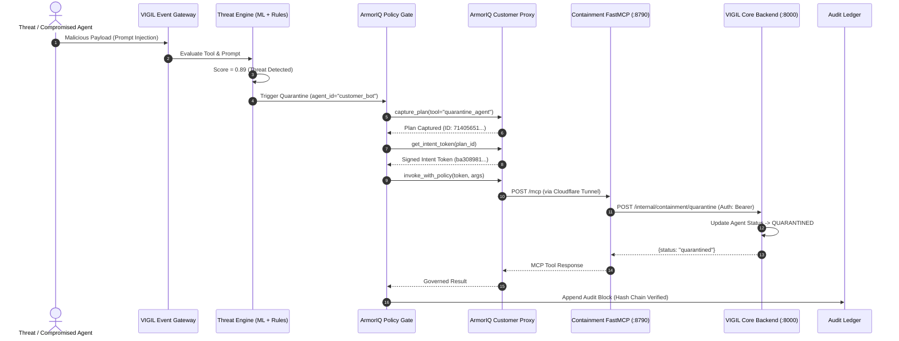
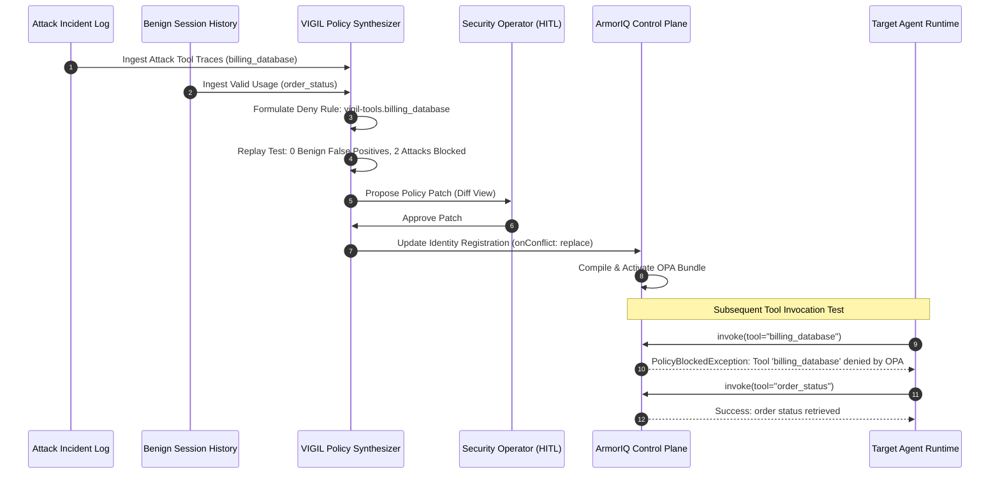

# VIGIL v2 Architecture: Autonomous Multi-Agent Defense & ArmorIQ Governance

## Executive Summary

VIGIL v2 is an enterprise-grade agentic defense platform designed to protect autonomous AI agents from jailbreaks, prompt injections, behavioral drift, and privilege escalation. Unlike passive monitoring tools, VIGIL v2 operates as an active, cryptographically governed control plane. By integrating the **ArmorIQ Policy Platform (`armoriq-sdk==0.6.10`)**, VIGIL v2 ensures that security containment actions (such as agent quarantines, credential revocations, and network isolations) are strictly bound to cryptographically signed intent tokens, enforced via Open Policy Agent (OPA) rules, and sealed in a tamper-evident audit ledger.

---

## 1. System Architecture

```mermaid
flowchart TD
    subgraph MultiAgentRuntime ["Multi-Agent Environment"]
        AgentA["Customer Support Agent"]
        AgentB["Data Extraction Agent"]
        AgentC["Code Execution Agent"]
    end

    subgraph VigilCore ["VIGIL v2 Defense Core"]
        Gateway["Event Ingestion & Interceptor"]
        
        subgraph Detector ["Dual-Engine Threat Detector"]
            Heuristics["Rule Engine & Regex\n(Injection, Exfiltration, Jailbreak)"]
            MLAnomaly["Isolation Forest & EWMA\n(Tool Calling Anomaly Model)"]
            Ensemble["Anomaly Aggregator\n(Score: [0.0 - 1.0])"]
        end
        
        subgraph ApprovalChannel ["Approval Channel (Human-in-the-Loop)"]
            Slack["Slack Approval Channel\n(Block Kit / HMAC / Corporate Email)"]
            Dashboard["Web Dashboard Governance\n(Operator Console)"]
        end

        Ledger["SHA-256 Hash-Chained\nAudit Ledger"]
        Synthesis["Policy Immune Synthesis &\nCounterfactual Replay Engine"]
    end

    subgraph ArmorIQCloud ["ArmorIQ Security Cloud"]
        ControlPlane["ArmorIQ Control Plane\n(Identity & Policy Management)"]
        Proxy["ArmorIQ Customer Proxy\n(https://customer-proxy.armoriq.ai)"]
        OPAEval["OPA Policy Engine\n(Signed Intent Tokens)"]
    end

    Gate["ArmorIQ Policy Gate\n(armoriq_gate.py / Fail-Closed)"]

    subgraph ContainmentServer ["Containment Plane (FastMCP Server)"]
        Tunnel["Cloudflare Tunnel\n(:8790 -> trycloudflare)"]
        FastMCP["vigil-containment FastMCP Server\n(Tool: quarantine_agent)"]
        InternalAPI["Internal Quarantine API\n(/internal/containment/quarantine)"]
    end

    MultiAgentRuntime -->|Telemetry / Tool Calls| Gateway
    Gateway --> Detector
    Heuristics --> Ensemble
    MLAnomaly --> Ensemble
    Ensemble -->|Threshold Exceeded (>0.45)| ApprovalChannel
    Ensemble -->|Log All Events| Ledger

    Slack -->|Approve / Reject Callback| Gate
    Dashboard -->|Operator Action| Gate
    Gate -->|1. capture_plan| Proxy
    Proxy -->|2. get_intent_token| OPAEval
    OPAEval -->|3. Signed Token / Policy Block| Proxy
    Proxy -->|4. Governed Actuation| Tunnel
    Tunnel --> FastMCP
    FastMCP -->|Bearer CONTAINMENT_SECRET| InternalAPI
    InternalAPI -->|Quarantine State Updated| MultiAgentRuntime
    Gate -->|Audit Entry Committed| Ledger

    Synthesis -->|Analyze Incidents vs Benign History| ControlPlane
    ControlPlane -->|Update Identity Policy| OPAEval
```

---

## 2. Core Components Breakdown

### 2.1 Threat Detection Engine (`backend/app/detection/`)
VIGIL v2 uses a hybrid multi-layer detection pipeline:
- **Heuristic Pattern Matchers**: Fast scanning for known attack patterns (e.g., direct instruction overrides, prompt injections, system prompt leak attempts, credential exfiltration signatures).
- **Statistical & ML Anomaly Detection**: An **Isolation Forest** paired with **Exponentially Weighted Moving Average (EWMA)** tracking temporal drift in tool calling frequencies, payload sizes, argument entropy, and call sequences.
- **Ensemble Aggregator**: Produces a unified threat score `S \in [0.0, 1.0]`. If `S < 0.45`, events are recorded as benign. If `S >= 0.45`, an alert is generated and escalated to governance.

### 2.2 ArmorIQ Policy Gate (`backend/app/policies/armoriq_gate.py`)
Containment actions in VIGIL v2 cannot be triggered unilaterally by the threat engine or even by an operator directly. Instead, every containment actuation must pass through the **ArmorIQ Gate**:
1. **Plan Capture (`capture_plan`)**: Captures the operator/agent identity, the target MCP server (`vigil-containment-v2`), the tool (`quarantine_agent`), and sanitized arguments (`agent_id`, `reason`).
2. **Intent Token Minting (`get_intent_token`)**: Exchanges the plan with the ArmorIQ Control Plane. The platform evaluates OPA constraints and returns a cryptographically signed intent token.
3. **Governed Invocation (`invoke_with_policy`)**: Sends the invocation request with the intent token to the ArmorIQ Customer Proxy (`https://customer-proxy.armoriq.ai`). The proxy verifies the signature and policy constraints before proxying the call to the destination MCP.
4. **Strict Fail-Closed Semantics**:
   - `PolicyBlockedException` $\rightarrow$ Result: **DENIED**.
   - `PolicyHoldException` $\rightarrow$ Result: **ESCALATE** (Human hold pending; never auto-approved).
   - Network/SDK errors $\rightarrow$ Result: **ESCALATE** (Never falls back to permissive execution).

### 2.3 Containment FastMCP Server (`backend/app/policies/containment_mcp.py`)
- Implemented using the Model Context Protocol (MCP) over Streamable HTTP (FastMCP).
- Listens on `http://127.0.0.1:8790`.
- Exposes `quarantine_agent(agent_id, reason)` tool.
- Requires `CONTAINMENT_SECRET` bearer token authentication when calling VIGIL's `/internal/containment/quarantine` endpoint, ensuring zero unauthorized actuation paths.
- Exposed to the ArmorIQ proxy via an encrypted `cloudflared` tunnel. Port 8000 remains strictly localhost-only.

### 2.4 Cryptographic Audit Ledger (`backend/app/runtime/ledger.py`)
Every decision, raw tool call, anomaly score, approval request, and policy outcome is committed to an append-only cryptographic ledger (`backend/storage/audit_ledger.jsonl`).
- **SHA-256 Hash Chaining**: Each block contains `prev_hash`, creating an immutable cryptographic chain:
  $$\text{Hash}_i = \text{SHA256}(\text{sequence}_i \parallel \text{timestamp}_i \parallel \text{event\_type}_i \parallel \text{data}_i \parallel \text{Hash}_{i-1})$$
- **Tamper Detection**: An endpoint `GET /audit/verify` verifies the chain from genesis to head. Any modification, gap, deletion, or reordering breaks the chain immediately and identifies the exact sequence number compromised.

### 2.5 Incident-to-Policy Closed-Loop Synthesis (`backend/app/policies/synthesis.py`)
When a novel attack vector is detected and mitigated:
1. The **Synthesis Engine** extracts the anomalous tool invocations and payloads from the ledger.
2. It generates candidate OPA deny policies in ArmorIQ YAML format (e.g., `DENY vigil-tools.billing_database`).
3. **Replay Validation**: The proposed rule is replayed against historic benign sessions to verify zero false positives (ensuring no valid business tools are broken).
4. **Platform Registration**: The approved patch is committed to the ArmorIQ Control Plane (`POST /api/v1/registrations` with `onConflict: "replace"`).
5. **Live Verification**: Subsequent malicious tool calls are blocked at the OPA proxy level before reaching the agent runtime.

---

## 3. Data & Control Flows

### 3.1 Live Governed Containment Flow


### 3.2 Closed-Loop Policy Synthesis Flow


---

## 4. Security & Compliance Invariants

| Invariant | Implementation Mechanism | Enforcement Point |
| :--- | :--- | :--- |
| **Fail-Closed Gate** | `PolicyBlockedException` $\rightarrow$ DENY; `PolicyHoldException` or errors $\rightarrow$ ESCALATE | `backend/app/policies/armoriq_gate.py` |
| **No Silent Bypass** | Containment actions require a signed intent token from ArmorIQ | ArmorIQ Customer Proxy & OPA |
| **Secret Isolation** | Secrets (`ARMORIQ_API_KEY`, `CONTAINMENT_SECRET`) never logged, committed, or exposed | `.env`, gitignore, sanitized logs |
| **Network Boundary** | VIGIL Core (:8000) is localhost-only. Only MCP endpoints (:8790, :8791) tunnel out | Cloudflare tunnels & OS bind address |
| **Ledger Immutability** | Cryptographic SHA-256 hash chaining with sequence verification | `backend/app/runtime/ledger.py` |
| **Zero Regression Policy**| Candidate deny rules must pass replay against benign history | `backend/app/policies/synthesis.py` |
