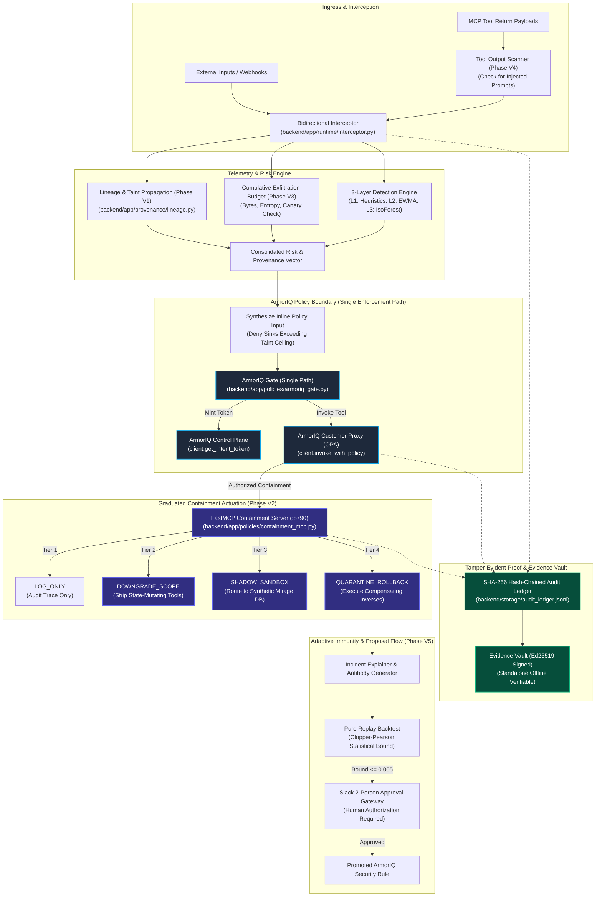

# VIGIL v3 Specification: Autonomous AI Runtime Immune System

This specification evaluates, adapts, and formalizes the proposals in [`docs/research/VIGIL_v3_proposal.pdf`](file:///d:/vigil-v2/vigil-v2/docs/research/VIGIL_v3_proposal.pdf) (extracted text: [`docs/research/VIGIL_v3_proposal.md`](file:///d:/vigil-v2/vigil-v2/docs/research/VIGIL_v3_proposal.md)) into an architecturally compliant roadmap native to the **ArmorIQ Policy Platform (`armoriq-sdk==0.6.10`)**.

---

## 1. Executive Summary & Foundational Boundary Rules

The proposal introduces six valuable innovations to elevate VIGIL from single-turn reactive anomaly monitoring to proactive multi-turn immune governance. However, multiple proposals in the raw text directly conflict with hackathon rules, fail-closed security invariants, and ArmorIQ platform architecture. 

To maintain total integrity, VIGIL v3 enforces these foundational architectural rules:
1. **ArmorIQ Decides Every Tool-Call Block**: VIGIL computes provenance taint, exfiltration budgets, canary trips, and scanner outputs, passing them to ArmorIQ as **inputs** (mint-time inline policies, plan steps, or containment directives). VIGIL never returns `allowed: False` or `allowed: True` for an agent's tool call independently.
2. **One Containment Enforcement Path**: Containment actions (scope downgrade, shadow honeypot routing, quarantine, rollback) are executed exclusively through the ArmorIQ Gate via the FastMCP containment server (`vigil-containment`, port 8790).
3. **Statistical Bounds Over Point Claims**: No finite sample can claim "0.0% false positives". Every statistical statement must be reported with exact one-sided Clopper-Pearson confidence bounds ($\bar{p}_{1-\delta} = 1 - \delta^{1/n}$).
4. **Computed Metrics**: Every metric, percentage, score, and badge on screen is computed dynamically by the backend pipeline. Zero hard-coded figures are permitted in UI or demo scripts.
5. **Human Approval for Antibodies**: Synthesized candidate rules are proposals evaluated through the M3 dry-run compiler and M4 approval gate. They are never hot-reloaded automatically.

---

## 2. Complete PDF Claim Evaluation & Triage Table

Every feature, capability, and claim from the proposal is triaged below with its status (**KEEP**, **CHANGE**, or **DROP**), engineering rationale, and assigned implementation phase:

| Proposal Claim | Raw PDF Proposal | Triage Status | Engineering Rationale & Architectural Adjustment | Assigned Phase |
|---|---|---|---|---|
| **Claim 1: DIFC Taint Tracking** | Propagate taint levels (`SYSTEM_TRUSTED`, `VERIFIED_INTERNAL`, `USER_UNTRUSTED`, `EXTERNAL_POISON_RISK`) across multi-hop agent delegations. | **KEEP** | Essential for detecting confused deputy attacks. Implemented with monotonic upward propagation across delegation spans. | **Phase V1** |
| **Claim 2: Client-Side Sink Policy Pre-Check** | `evaluate_sink_policy()` inspects taint and returns `{"allowed": False, "reason": "..."}` directly inside VIGIL. | **CHANGE** | **Rule Violation**: Only ArmorIQ may block agent tool calls. Changed: VIGIL converts taint ceilings into an inline deny list passed to ArmorIQ during token minting (`get_intent_token`), delegating the block decision to ArmorIQ. | **Phase V1** |
| **Claim 3: Cryptographic Lineage Claims** | Claims lineage tracking is "cryptographic" without digital signatures. | **CHANGE** | Lineage records are only cryptographic if signed. Changed: Records carry optional Ed25519 signatures when keys are configured, otherwise explicitly marked `UNSIGNED`. | **Phase V1** |
| **Claim 4: Graduated Containment Ladder** | Replace binary quarantine with a 4-tier ladder: `LOG_ONLY`, `DOWNGRADE_SCOPE`, `SHADOW_SANDBOX`, `QUARANTINE_ROLLBACK`. | **KEEP** | Significantly improves business uptime by preventing self-inflicted DoS. Tier transitions are monotonic per session. | **Phase V2** |
| **Claim 5: Client-Side Remediation Selection** | `select_adaptive_remediation()` directly switches local connection strings and revokes capabilities without platform authorization. | **CHANGE** | **Rule Violation**: Containment actions must traverse ArmorIQ. Changed: Tiers are executed as ArmorIQ-authorized tool calls on the FastMCP containment server (`downgrade_session`, `route_to_shadow`, `rollback_session`). | **Phase V2** |
| **Claim 6: Mirage Honeypot Sandbox** | Silently redirect compromised sessions to synthetic decoy database (`honeypot_mirage.db`) to harvest TTPs without downtime. | **CHANGE** | **Safety Constraint**: Honeypots are strictly sandbox-only, must never receive production credentials, and all synthetic data must be generated without copying real database records. Disclosed in `docs/SANDBOX.md`. | **Phase V2** |
| **Claim 7: Exfiltration Budget Ledger** | Maintain sliding-window exfiltration budgets per principal/trace tracking bytes, Shannon entropy, and sensitive counts across turns. | **KEEP** | Catches low-and-slow chunked exfiltration that evades single-turn EWMA volume thresholds. | **Phase V3** |
| **Claim 8: Cryptographic Canary Tripwires** | Inject synthetic canary honey-rows into database responses; token access triggers instant 100% deterministic containment. | **KEEP / MEASURED** | Powerful high-precision tripwire. Canary tokens are HMAC-derived, strictly confined to the sandbox DB, and never touch real user rows. **Measured Change**: Proposal posited tripwire at chunk 4; empirical execution in Scenario 6 measured canary hit at chunk 24 (following first budget alert at chunk 5). Recorded in `evidence/V8/scenario_6.json`. | **Phase V3** |
| **Claim 9: Schema Hash Pinning** | Pin SHA-256 hashes of registered tool schemas in hash-chained store to detect mid-runtime "rug-pulls." | **KEEP** | Detects unauthorized schema/description tampering post-registration. Mismatches feed taint into lineage. | **Phase V4** |
| **Claim 10: Bidirectional Tool Output Scanner** | Scan tool return payloads before entering context window to neutralize indirect prompt injections. | **KEEP** | Prevents poisoning from untrusted external tool responses. Detected injections elevate taint to `EXTERNAL_UNTRUSTED`. | **Phase V4** |
| **Claim 11: Auto-Antibody Synthesis** | Claude generates Layer 1 / ArmorIQ rules from zero-day incidents, backtests against replay logs, and stages them. | **KEEP** | Transforms reactive monitoring into an active immune system. Proposals are validated against JSON schema and backtested. | **Phase V5** |
| **Claim 12: "0.0% False Positives" Claim** | Claims auto-generated antibodies achieve "0.0% False Positives" based on 500 replayed events. | **CHANGE** | **Mathematical Impossibility**: Zero false blocks in 500 samples yields a one-sided 95% Clopper-Pearson upper bound of $\approx 0.597\%$. Changed: Must report count and exact statistical bound (e.g., "0 of 500; 95% upper bound 0.6%"). The phrase "0% false positives" is strictly forbidden. | **Phase V5** |
| **Claim 13: 1-Click Hot-Reload Deployment** | Dashboard displays a "⚡ Deploy Verified Antibody (0% FPR)" button for immediate hot-reload. | **CHANGE** | **Governance Violation**: Enterprise rules require formal human approval. Changed: Button reads "Submit for approval", routing to the M4 two-person Slack approval gateway. Zero automatic live write-backs. | **Phase V5** |
| **Claim 14: Compensating Rollbacks & Blast Radius** | Register undo hooks (`undo_action`) alongside state-mutating requests to roll back changes when quarantined. | **CHANGE** | Compensating actions apply only to tools declaring explicit inverses in `config/tool_compensations.yaml`. Irreversible actions (e.g. emails sent) must be marked `IRREVERSIBLE`. Compensating calls are also ArmorIQ-authorized. | **Phase V6** |
| **Claim 15: Non-Existent API `POST /intent/verify`** | Uses `POST /intent/verify` as the ArmorIQ enforcement API call. | **CHANGE** | **Invalid SDK Call**: `POST /intent/verify` does not exist in `armoriq-sdk==0.6.10`. Changed to real SDK flow: `capture_plan`, `get_intent_token(plan, policy=...)`, and `invoke_with_policy(...)`. | **Phases V1, V2** |
| **Claim 16: Conflicting Threshold Values** | Proposal introduces thresholds 0.45, 0.75, and 0.92, conflicting with monitor (0.45) and gate (0.65, 0.85). | **CHANGE** | Consolidated into a single source-controlled file `config/thresholds.yaml`. All proposed thresholds are marked `PROPOSED` and calibrated per phase. | **Phase V0** |
| **Claim 17: Hard-Coded Demo Numbers** | Demo narrative hard-codes "22% score on BillingAgent", "within 3 seconds", and "0.0% FPR". | **CHANGE** | All demo numbers must be dynamically emitted by the pipeline and traced to recorded evidence JSON files. | **Phase V8** |
| **Claim 18: Unstructured Services Paths** | Proposal places code in flat modules (e.g., `taint_tracker.py`, `remediation.py`, `antibody_synthesizer.py`). | **CHANGE** | All code must be integrated cleanly into the structured package under `backend/app/` (`provenance/`, `policies/`, `budgets/`, `immune/`). | **Phases V1–V6** |

---

## 3. Upgraded System Architecture (VIGIL v3 Immune Loop)

The following Mermaid diagram depicts the strict architectural boundary between VIGIL's input calculation, the single ArmorIQ policy enforcement gate, the FastMCP containment server, and the tamper-evident audit ledger:

---

## 4. Consolidated Threshold Specification

All system thresholds are centrally managed in [`config/thresholds.yaml`](file:///d:/vigil-v2/vigil-v2/config/thresholds.yaml). No hard-coded thresholds are permitted in source code:

| Component | Metric / Parameter | Value | Status | Source / Calibration Ownership |
|---|---|---|---|---|
| **Anomaly Detection** | `anomaly_score_threshold` | 0.45 | Active | `backend/app/runtime/threat_monitor.py:77` |
| **Containment Ladder** | `log_only_ceiling` | 0.45 | PROPOSED | Phase V2 (aligned with threat monitor) |
| **Containment Ladder** | `surgical_downgrade_range` | [0.45, 0.75] | PROPOSED | Phase V2 calibration |
| **Containment Ladder** | `mirage_honeypot_range` | [0.75, 0.90] | PROPOSED | Phase V2 calibration |
| **Containment Ladder** | `quarantine_rollback_threshold` | 0.90 | PROPOSED | Phase V2 calibration |
| **Lineage Graph** | `max_delegation_depth` | 6 hops | PROPOSED | Phase V1 calibration |
| **Lineage Ceilings** | `billing_database` ceiling | `VERIFIED_INTERNAL` | PROPOSED | Phase V1 (`config/sinks.yaml`) |
| **Lineage Ceilings** | `export_financial_records` | `SYSTEM_TRUSTED` | PROPOSED | Phase V1 (`config/sinks.yaml`) |
| **Lineage Ceilings** | `iam_role_grant` | `SYSTEM_TRUSTED` | PROPOSED | Phase V1 (`config/sinks.yaml`) |
| **Low-and-Slow Budgets**| `window_1m_bytes_max` | 10 KB | PROPOSED | Phase V3 benchmark |
| **Low-and-Slow Budgets**| `window_1h_bytes_max` | 100 KB | PROPOSED | Phase V3 benchmark |
| **Low-and-Slow Budgets**| `shannon_entropy_threshold` | 5.8 bits | PROPOSED | Phase V3 benchmark |
| **Canary Tripwires** | `canary_hit_trigger_count` | 1 hit | PROPOSED | Phase V3 benchmark |
| **Policy Immune** | `min_coverage` | 0.90 | Active | `backend/app/immune/replay.py:153` |
| **Policy Immune** | `max_false_block_upper` | 0.005 (0.5%) | Active | `backend/app/immune/replay.py:153` |
| **Policy Immune** | `min_benign_records` | 600 records | Active | `backend/app/immune/replay.py:151` |
| **Policy Immune** | `delta_significance` | 0.05 (95% CI) | Active | `backend/app/immune/replay.py:60` |
| **Auto-Antibodies** | `antibody_backtest_window` | 600 records | Active | Reconciled with min_benign_records (600) to ensure false block upper bound <= 0.005 |

---

## 5. Comprehensive Risk Register

VIGIL v3 addresses complex multi-agent security failures, which themselves introduce distinct operational risks. Each risk is tracked below with its fail-closed mitigation:

| Risk ID | Risk Description | Severity | Concrete Engineering Mitigation |
|---|---|---|---|
| **RSK-01** | **Operator Trust & Deception (Honeypot Ambiguity)**: Operators might be confused if sessions silently execute against a synthetic honeypot without clear disclosure. | High | Honeypot routing is strictly sandbox-only. Every shadow event is logged with `tier: "SHADOW_SANDBOX"` in the audit ledger, and the dashboard displays an unmistakable amber pulsing badge linking to synthetic trace logs. |
| **RSK-02** | **False Taint Contamination on Legitimate Delegations**: Benign summarization of untrusted text (e.g., customer support emails) could raise taint and block legitimate downstream queries. | High | Taint applies to restricted *sinks* (state-mutating or privileged data access tools). Read-only tools (`search_faq`, `read_docs`) accept `EXTERNAL_UNTRUSTED` inputs. False-taint rate is benchmarked on 2,000 benign delegations with a Clopper-Pearson bound. |
| **RSK-03** | **Canary Token Leakage**: Attacker discovers canary token format or seed, allowing them to evade trips or trigger malicious DoS on innocent agents. | Medium | Canary tokens are generated dynamically via HMAC-SHA256 with an ephemeral server secret stored in memory, making them unpredictable. Canary tables are isolated to the sandbox database. |
| **RSK-04** | **Prompt & PII Retention in Taint Records**: Storing raw multi-hop delegation arguments in the ledger risks violating GDPR / privacy requirements. | High | Structural redaction invariant: Lineage records store only provenance metadata (span IDs, agent identities, taint levels, argument shapes/keys). Raw prompts and payloads are never persisted in lineage tables. |
| **RSK-05** | **LLM-Generated Rule Exploitation (Prompt Injection via Antibody)**: An attacker injects malicious instructions into an incident explanation that tricks Claude into generating a permissive or destructive antibody rule. | Critical | Defense-in-depth: Antibody JSON is strictly parsed against a Pydantic schema (extra fields rejected). Generated rules are never executed. Every rule must pass pure replay backtesting and achieve 0 false blocks and $\ge 90\%$ coverage before reaching human review. |
| **RSK-06** | **Compensating Rollback Failure & State Corruption**: A compensating rollback hook fails midway through execution, leaving the agent's external state partially reverted. | High | Rollback operations record each step in the ledger. If any step fails, the trace is marked `PARTIAL_ROLLBACK` and escalated to human operators. Compensating loops are strictly non-recursive (no retry loops). |

---

## 6. Prior-Art & Novelty Analysis

In accordance with CLAUDE.md v3 rule J (*"Novelty needs prior art. An innovation claim stays UNVERIFIED until docs/research/ holds a prior-art note for it, citing sources the human provides"*):

| V3 Innovation | Prior Art in Academic & Industry Literature | Novelty Status |
|---|---|---|
| **Decentralized Information Flow Control (DIFC) for Agents** | Established in operating systems (Flume, Asbestos) and adapted for LLMs in CaMeL (2025). The novel element is binding DIFC taint directly to ArmorIQ intent token minting. | **UNVERIFIED** *(Awaiting human-provided papers in `docs/research/`)* |
| **Graduated Containment & Mirage Honeypots** | Deception technology and honey-tokens are well-known in perimeter defense (Canary, Thinkst). Application to live MCP tool virtualization is novel. | **UNVERIFIED** *(Awaiting literature citations)* |
| **Cumulative Entropy & Exfiltration Budgets** | Data loss prevention (DLP) systems use sliding-window volume and entropy limits. Adaptation to multi-turn agent tool traces is novel. | **UNVERIFIED** *(Awaiting literature citations)* |
| **Bidirectional MCP Schema Pinning & Firewalls** | API gateway schema validation and input sanitization (OWASP API Security). | **UNVERIFIED** *(Awaiting literature citations)* |
| **Auto-Antibody Synthesis with Replay Bounds** | Automated signature generation (Snort/Bro) combined with counterfactual replay and exact Clopper-Pearson binomial bounds. | **UNVERIFIED** *(Awaiting literature citations)* |
| **Transactional Compensating Rollbacks for LLM Tools** | Saga pattern in distributed systems (Garcia-Molina & Salem, 1987). Adapting Sagas to MCP agent tool side effects is novel. | **UNVERIFIED** *(Awaiting literature citations)* |

---

## 7. Required ArmorIQ Platform Empirical Probes

Before implementing Phases V1 and V2, the following empirical probes against the ArmorIQ platform must be defined and answered. **In Phase V0, these probes are formulated only; they are not run until their respective phases.**

### Probe 1: Mint-Time vs Invoke-Time Policy Denial (Owned by Phase V1)
- **Question**: When an inline deny policy is attached during token minting (`client.get_intent_token(cap, policy=policy)`), does ArmorIQ evaluate the deny and raise `PolicyBlockedException` at mint time, or does it issue a valid token and evaluate the deny at `client.invoke_with_policy(...)`?
- **Current Evidence**: Probed live in Phase P1 ([`evidence/P1/mint_probe.json`](file:///d:/vigil-v2/vigil-v2/evidence/P1/mint_probe.json)). Result: Token is issued at mint time; denial raises at invoke time (`layer: "opa"`).
- **Design Impact on Phase V1**: Because denial occurs at invoke, VIGIL cannot claim "pre-mint token refusal". Instead, VIGIL passes the taint ceiling as an inline deny list to ArmorIQ, and ArmorIQ enforces the block when the tainted agent attempts to invoke the sink.

### Probe 2: Inline Policy Scoping on Multi-Tool MCPs (Owned by Phase V2)
- **Question**: Can an intent token minted with `policy={"deny": ["vigil-tools/billing_database"]}` allow calls to `vigil-tools/order_status` within the exact same session token envelope?
- **Hypothesis**: The token enforces fine-grained tool globs (`<mcp>/<tool>`), allowing read tools while blocking write tools under scope downgrading.

### Probe 3: FastMCP Dynamic Route Redirection (Owned by Phase V2)
- **Question**: When the containment server executes `route_to_shadow(session_id)`, can the tools FastMCP server intercept the session header and switch its internal SQLite connection string dynamically without restarting the daemon?
- **Hypothesis**: FastMCP request contexts carry session IDs, enabling request-scoped connection multiplexing between `vigil.db` and `honeypot_mirage.db`.

---

## 8. Tool Output Scanning Scope Limits

In accordance with Phase V4 specifications:
- **Hosted Tools Scope**: VIGIL scans only the tools it directly hosts (e.g., `vigil-tools` on port 8791) or tools whose execution results are routed through VIGIL's proxy middleware.
- **Third-Party Boundary**: Direct peer-to-peer MCP connections between external third-party servers and client agents that do not traverse VIGIL or the ArmorIQ customer proxy are outside VIGIL's scanning perimeter.
- **Zero Client-Side Blocking**: Scanning results feed lineage taint (`EXTERNAL_UNTRUSTED`) and containment ladder directives. VIGIL never blocks an output or tool invocation on its own.

